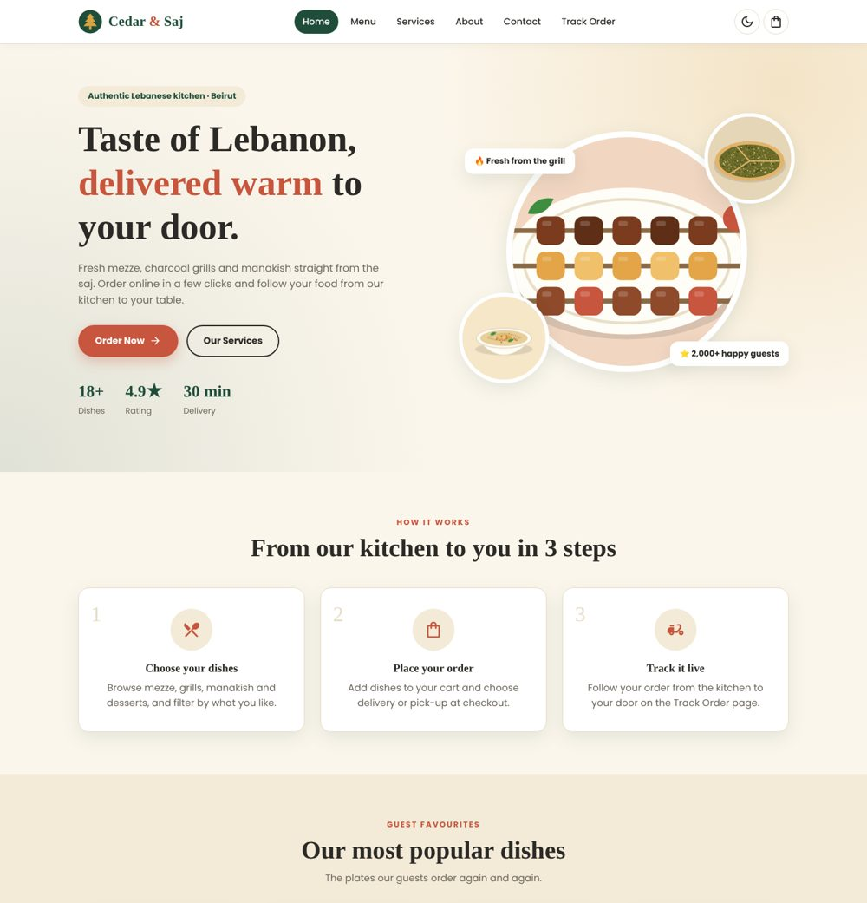
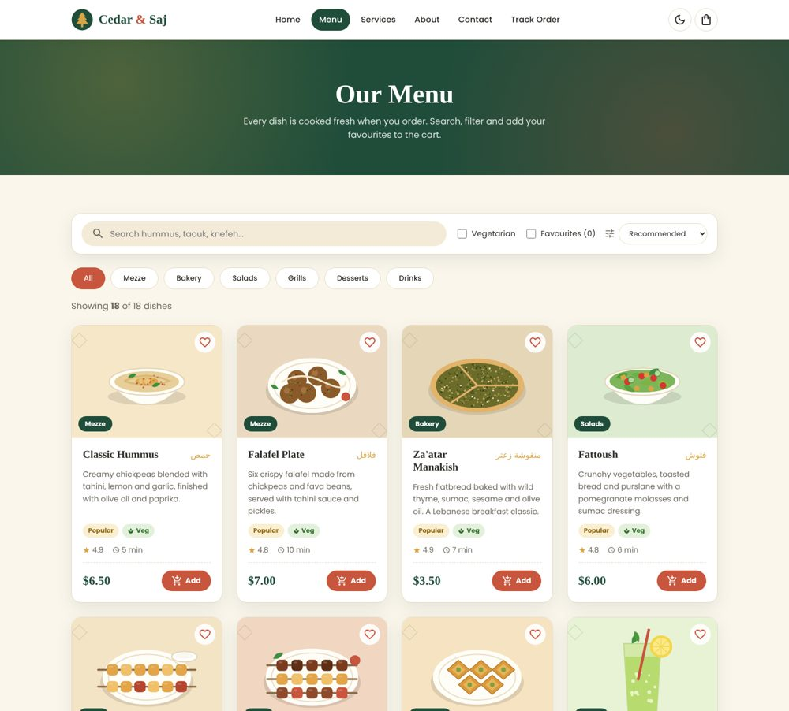
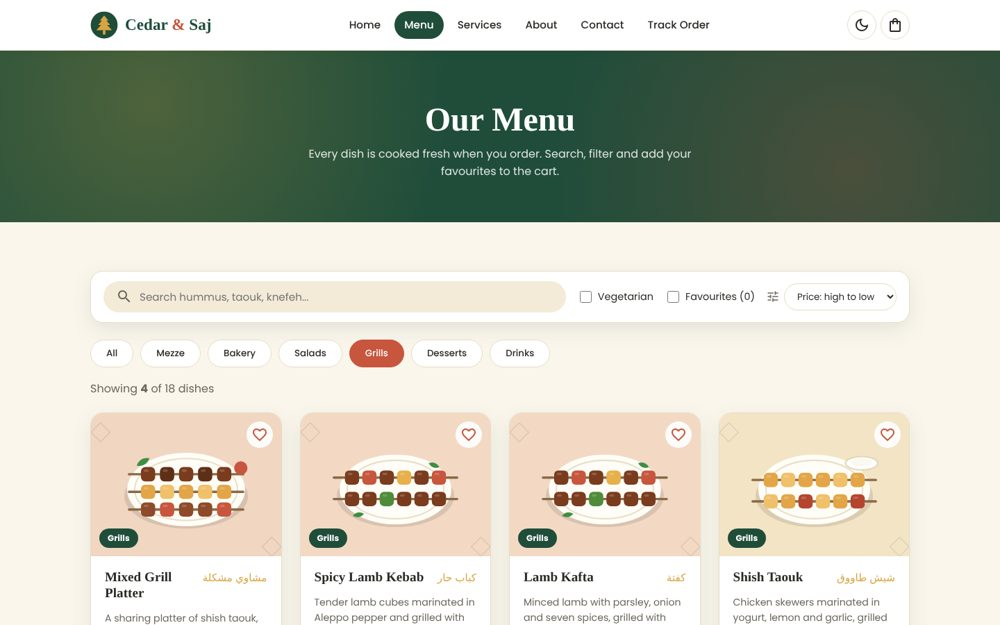
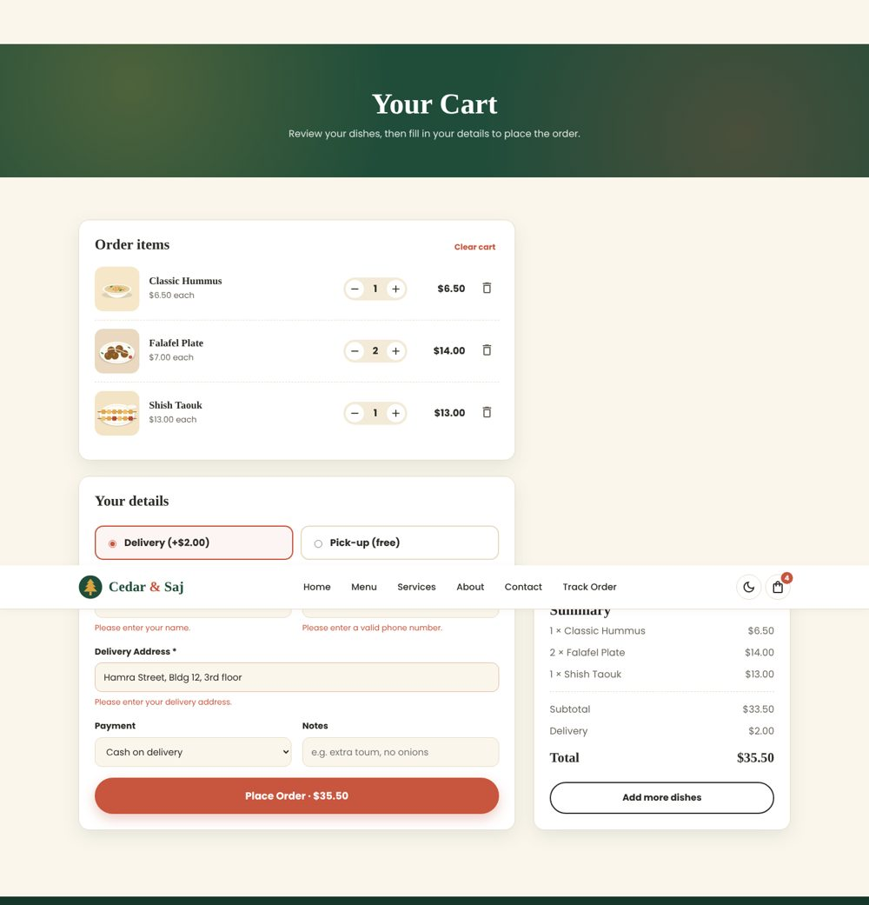
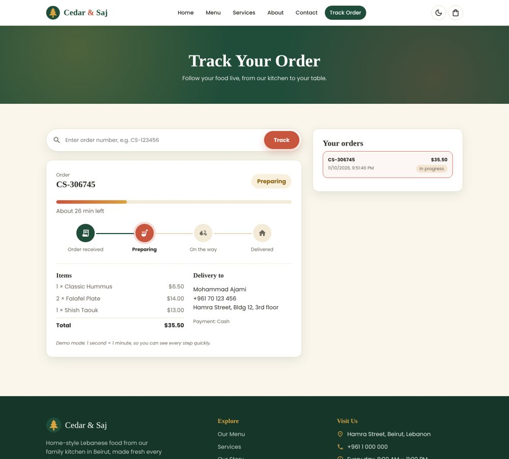
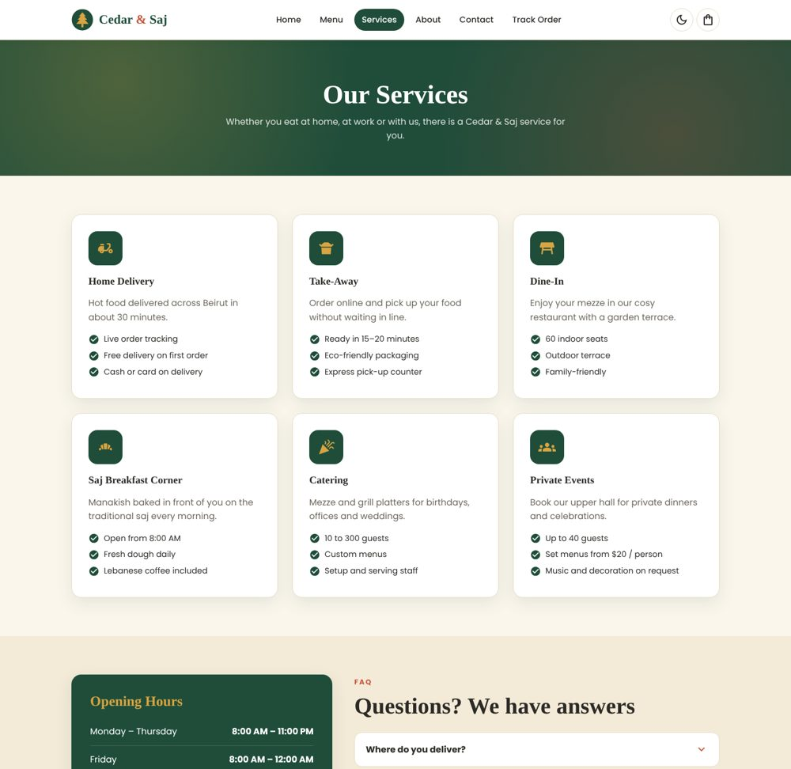
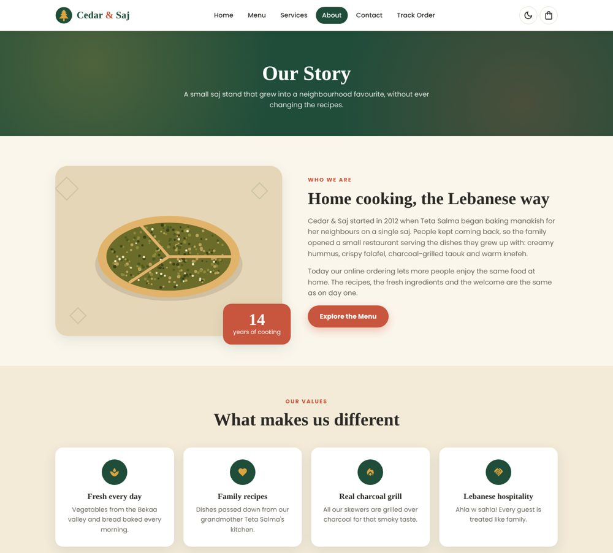
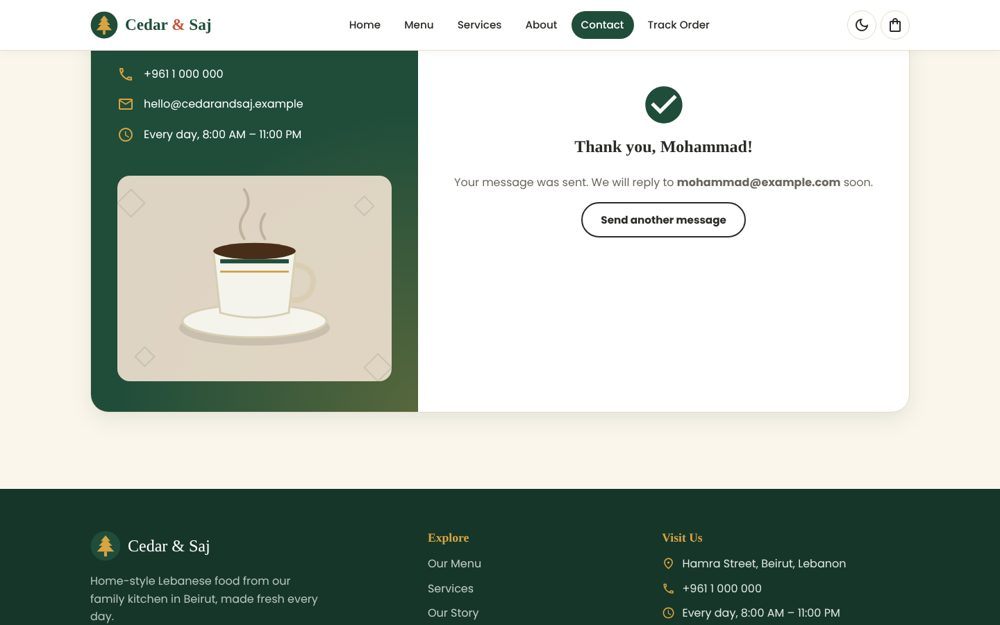
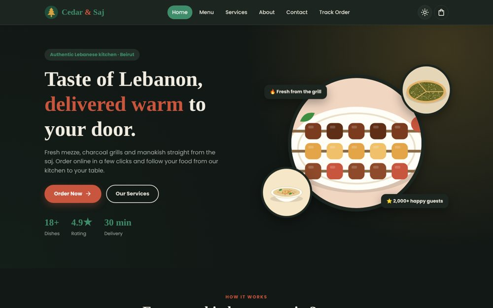
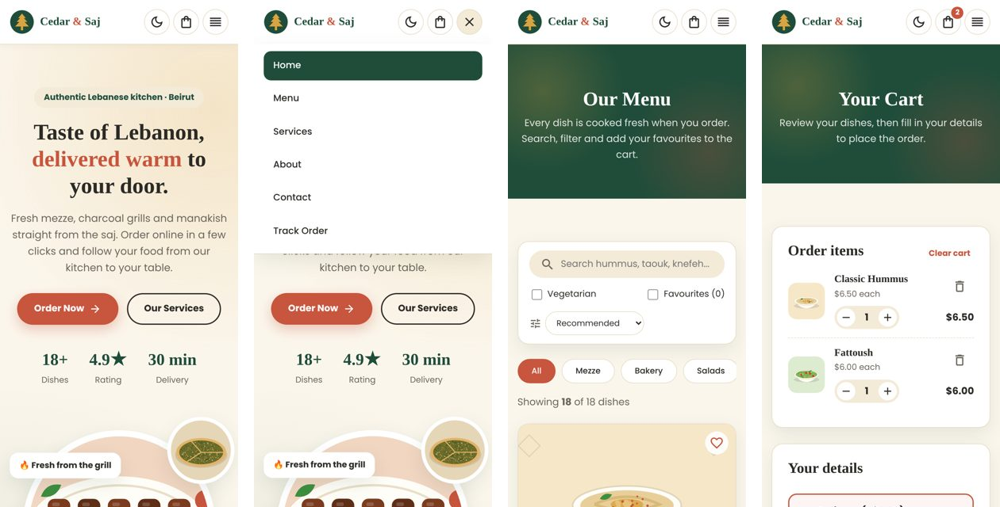

# Cedar & Saj – Lebanese Restaurant Ordering System

**CSCI426 Advanced Web Programming – Project Phase 1 (Fall 2026)**

Cedar & Saj is a responsive restaurant ordering website built with **ReactJS**. Customers can browse a Lebanese menu, search and filter dishes, save favourites, add dishes to a cart, place an order for delivery or pick-up, and follow the order live on a tracking page.

🔗 **Live demo:** https://mohmdajami.github.io/Cedar---Saj/



---

## Features

| Page | Route | What it does |
|------|-------|--------------|
| **Home** | `/` | Hero section, "how it works" steps, popular dishes loaded from JSON, guest reviews |
| **Menu** *(dynamic page)* | `/menu` | Dishes fetched from `public/data/menu.json`; live search, category filter, vegetarian and favourites filters, sorting by price / rating / name |
| **Services** | `/services` | Delivery, take-away, dine-in, catering and events; opening hours; FAQ accordion |
| **About** | `/about` | Restaurant story, values, timeline and team |
| **Contact** | `/contact` | Controlled form with validation and a success message |
| **Cart** | `/cart` | Change quantities, remove items, delivery or pick-up, validated checkout form |
| **Track Order** | `/track` | Live progress bar and steps (received → preparing → on the way → delivered), order history, search by order number |
| **404** | `*` | Friendly "page not found" page |

Also included:

- **Responsive design** for desktop, tablet and mobile, with a hamburger menu on small screens
- **Dark / light theme** shared with `useContext` and remembered in `localStorage`
- **Cart, favourites and orders saved** in `localStorage`, so nothing is lost on page refresh
- Cart badge in the NavBar showing the number of items

## Technologies Used

- **ReactJS** (Create React App) – components, props, JSX, `.map()` with keys
- **React Hooks** – `useState`, `useEffect`, `useContext`
- **React Router** (`react-router-dom`) – `BrowserRouter`, `Routes`, `Route`, `Link`, `NavLink`
- **MUI Icons** (`@mui/icons-material`) with Emotion
- **CSS3** – one CSS file per component, CSS variables, Flexbox, Grid, media queries
- **JSON + Fetch API** – menu data loaded from `public/data/menu.json`
- **localStorage** – `JSON.stringify` / `JSON.parse` with `try/catch`
- **Git & GitHub** – version control; **GitHub Actions + GitHub Pages** – hosting

## Project Structure

```
cedar-table/
├── public/
│   ├── data/menu.json        # menu data (18 dishes)
│   ├── images/               # food illustrations (SVG)
│   └── index.html
├── src/
│   ├── components/           # NavBar, Footer, MenuCard, SectionTitle, Logo, ScrollToTop
│   ├── context/              # ThemeContext, CartContext
│   ├── pages/                # Home, Menu, Services, About, Contact, Cart, TrackOrder, NotFound
│   ├── styles/               # one CSS file per component/page
│   ├── utils/storage.js      # localStorage helpers + price formatting
│   ├── App.js                # routes
│   └── index.js
├── docs/screenshots/
└── .github/workflows/deploy.yml
```

## Setup Instructions

**Requirements:** [Node.js](https://nodejs.org/) 18 or newer and npm.

```bash
# 1. Clone the repository
git clone https://github.com/MohmdAjami/Cedar---Saj.git
cd Cedar---Saj

# 2. Install the dependencies
npm install

# 3. Start the development server (opens http://localhost:3000)
npm start

# 4. Build for production (output in the build/ folder)
npm run build
```

## Deployment

The site deploys to **GitHub Pages** automatically with GitHub Actions (`.github/workflows/deploy.yml`):

1. Push the code to the `main` branch.
2. On GitHub, open **Settings → Pages** and set **Source** to **GitHub Actions** (one time only).
3. Every push to `main` builds the app and publishes it at https://mohmdajami.github.io/Cedar---Saj/.

The workflow sets `PUBLIC_URL` to the repository name, and `BrowserRouter` uses it as its `basename`. It also copies `index.html` to `404.html` so links like `/menu` still work after a page refresh.

## Screenshots

### Menu – search, filter and sort



### Cart and checkout


### Live order tracking


### Services, About and Contact




### Dark mode


### Mobile


## Notes

- Phase 1 is **frontend only**. Orders and messages are stored in the browser (`localStorage`). A backend will be added in a later phase.
- Order tracking runs in **demo mode** (1 second = 1 minute) so every step can be seen quickly.
- The restaurant, its address, team and reviews are **fictional**. The food illustrations were drawn for this project as SVG files.

## Team

- Mohammad Ajami – 72130193

Instructor: Kawthar Messelmani
